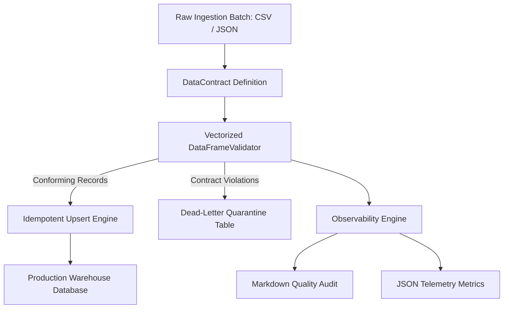

# DataFlow-Guard

[](https://github.com/loka0001/dataflow-guard/actions)
[](https://opensource.org/licenses/MIT)
[](https://www.python.org/downloads/)
[](https://pandas.pydata.org/)
[](https://pydantic.dev/)

> **Idempotent ETL Pipeline with Declarative Data Contracts, Vectorized Quality Assertions, Dead-Letter Quarantine, and Automated Observability.**

---

## Overview

Data pipelines break in production due to silent corruption: malformed records, null foreign keys, unexpected negative numbers, or unhandled enum states. Traditional ETL either crashes entirely or quietly corrupts downstream analytics.

**DataFlow-Guard** introduces a defensive, contract-driven architecture:
- Raw batches are validated against declarative schema contracts using fast vectorized Pandas assertions.
- Perfectly valid records are upserted **idempotently** into target tables using `ON CONFLICT` semantics.
- Corrupted rows are isolated in a dedicated **Dead-Letter Queue (Quarantine)** table with exact violation reasons for root-cause analysis.
- Executive Data Quality markdown and JSON reports are compiled after every batch execution.



---

## Key Features

- **📜 Declarative Data Contracts:** Define data types, non-nullability, primary keys, range bounds `[min .. max]`, regex patterns, and allowed enum sets in JSON or Pydantic models.
- **⚡ High-Speed Vectorized Validation:** Executes assertions across millions of rows using NumPy/Pandas boolean masks, achieving sub-second validation on large datasets.
- **🛡️ Isolated Dead-Letter Quarantine:** Invalid rows never touch production tables; they are diverted into a `dataflow_quarantine` table with exact root-cause failure traces and raw payloads.
- **🔄 Guaranteed Pipeline Idempotency:** Upserts data into destination SQL tables via primary key collision handling, allowing safe and repeated pipeline re-runs without duplicate record creation.
- **📊 Automated Executive Observability:** Generates stakeholder-ready Markdown reports with health badges (`🟢 PASSED` vs `🔴 QUARANTINE THRESHOLD EXCEEDED`), column violation breakdowns, and pass rate statistics.
- **🧪 100% Offline Testability:** Bundled with realistic clean and messy retail e-commerce datasets for comprehensive offline testing.

---

## Installation

```bash
# Clone the repository
git clone https://github.com/loka0001/dataflow-guard.git
cd dataflow-guard

# Install in editable mode with development dependencies
pip install -e .[dev]
```

---

## Quickstart & CLI Usage

Validate and ingest a dataset using a predefined contract:

```bash
python -m dataflow_guard.cli \
    --contract fixtures/orders_contract.json \
    --data fixtures/orders_batch_1.csv \
    --db output/production.db \
    --report output/quality_audit.md \
    --json-report output/metrics.json
```

### CLI Terminal Output:

```text
==================================================================
DataFlow-Guard: Enterprise Data Quality & Idempotent Ingestion
==================================================================
Contract Schema: fixtures/orders_contract.json
Source Data:     fixtures/orders_batch_1.csv
Target DB:       output/production.db
Quality Report:  output/quality_audit.md
------------------------------------------------------------------

Pipeline Ingestion Completed: SUCCESS [PASSED]
  * Total Rows Processed:   6
  * Clean Rows Upserted:    6 (Total DB Records: 6)
  * Quarantined Rows:       0 (Total DB Quarantine: 0)
  * Quarantine Ratio:       0.00%
  * Quality Report Saved:   output/quality_audit.md
==================================================================
```

---

## Defining a Data Contract

```json
{
  "name": "ecommerce_orders",
  "version": "1.0.0",
  "primary_key": ["order_id"],
  "max_quarantine_rate": 0.20,
  "columns": [
    {
      "name": "order_id",
      "data_type": "str",
      "nullable": false,
      "regex_pattern": "^ORD-\\d{5}$"
    },
    {
      "name": "order_amount",
      "data_type": "float",
      "nullable": false,
      "min_value": 0.01,
      "max_value": 50000.0
    },
    {
      "name": "status",
      "data_type": "str",
      "nullable": false,
      "allowed_values": ["PENDING", "COMPLETED", "SHIPPED", "CANCELLED", "REFUNDED"]
    }
  ]
}
```

---

## Running the Test Suite

```bash
pytest -v
```

All 100% of integration and unit tests execute completely offline in sub-second time.

---

## License & Attribution

This project is authored by **Malek Mesbah** and licensed under the **MIT License**. See [LICENSE](LICENSE) and [ATTRIBUTION.md](ATTRIBUTION.md) for details.
